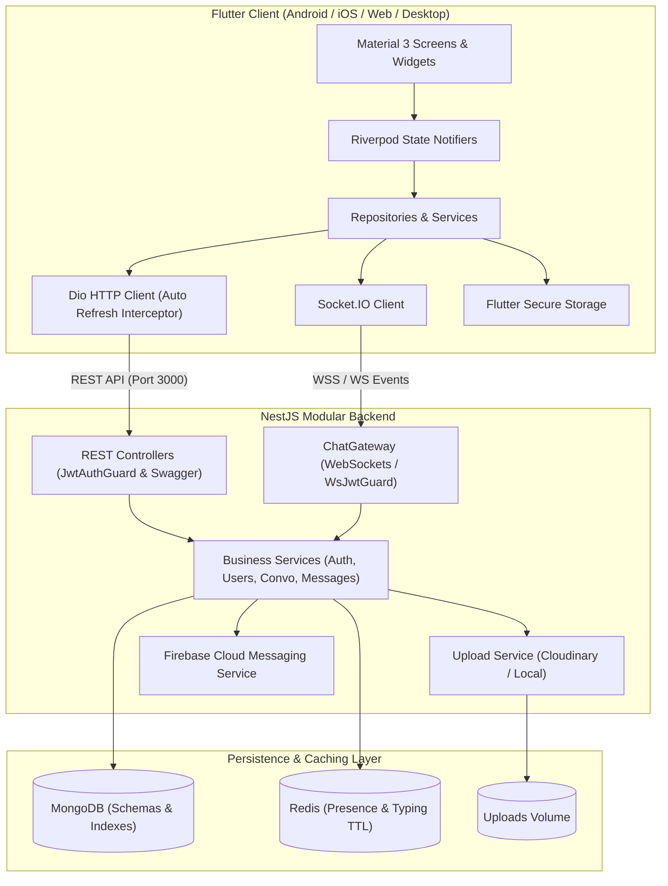

# Zylo 💬

[](https://github.com/mohammad-rahaman/Zylo/actions/workflows/ci.yml)
[](https://opensource.org/licenses/MIT)
[](https://flutter.dev)
[](https://dart.dev)
[](https://nestjs.com)
[](https://www.typescriptlang.org)
[](https://www.mongodb.com)
[](https://redis.io)
[](https://socket.io)
[](https://www.docker.com)

> A modern, production-grade cross-platform real-time messaging application built with **Flutter (Material 3 & Riverpod)**, **NestJS**, **MongoDB Atlas**, **Redis**, and **Socket.IO**.

📖 **[Read the Senior Engineering Portfolio & Resume Guide](PORTFOLIO_RESUME_GUIDE.md)** for interview talking points, resume bullet points, and deep-dive architecture answers.

---

## 📑 Table of Contents

- [Overview](#overview)
- [Portfolio & Interview Guide](PORTFOLIO_RESUME_GUIDE.md)
- [Architecture & Tech Stack](#architecture--tech-stack)
- [Database Design & Indexing](#database-design--indexing)
- [Real-Time Protocol (Socket.IO)](#real-time-protocol-socketio)
- [REST API Specification](#rest-api-specification)
- [Project Directory Structure](#project-directory-structure)
- [Environment Configuration](#environment-configuration)
- [Getting Started](#getting-started)
  - [Prerequisites](#prerequisites)
  - [Option A: Running with Docker Compose (Recommended)](#option-a-running-with-docker-compose-recommended)
  - [Option B: Running Locally for Development](#option-b-running-locally-for-development)
- [Testing](#testing)
- [Production & Security Best Practices](#production--security-best-practices)

---

## 🌟 Overview

Zylo is an end-to-end, production-ready messaging platform designed for real-time responsiveness, resilience, and scale. Key capabilities include:

- **Authentication & Security:** JWT Access & Refresh token rotation with bcrypt password hashing, automatic token re-issuance via Dio interceptors on Flutter, and HTTP-only cookie support.
- **Real-Time Communication:** Bi-directional Socket.IO gateways with JWT handshake verification, personal user rooms, and real-time delivery (`sent` ➔ `delivered` ➔ `read`).
- **Presence & Ephemeral State:** Redis-backed presence tracking (`online`/`offline` with `lastSeen` timestamps) and auto-expiring ephemeral typing indicators.
- **Media Management:** Multi-part file uploads (images, audio, video, documents) with local storage fallback and Cloudinary CDN support.
- **Push Notifications:** Firebase Cloud Messaging (FCM) device token registration and background push dispatch for offline participants.
- **Clean Architecture:** Domain-driven modular patterns in both backend (NestJS modules, services, controllers, gateways) and frontend (Riverpod state providers, repositories, services, and Material 3 design system).

---

## 🏗️ Architecture & Tech Stack



### Technology Highlights

| Component | Technology | Rationale |
| :--- | :--- | :--- |
| **Frontend Framework** | Flutter 3.x (Dart 3.x) | High performance, single codebase across iOS, Android, Web, and Desktop |
| **UI Design System** | Material 3 (Material You) | Modern aesthetics, dynamic color palettes, light & dark theme support |
| **State Management** | Flutter Riverpod 2.x | Compile-safe dependency injection, reactivity, and testability |
| **Routing** | GoRouter | Declarative routing with deep linking and reactive auth redirect guards |
| **Networking** | Dio + Socket.IO Client | Robust interceptors, token refresh queuing, low-latency WebSockets |
| **Backend Framework** | NestJS 10.x (TypeScript) | Enterprise-grade architectural modularity, DI, and native Swagger |
| **Database** | MongoDB 7.x + Mongoose 8.x | Flexible document model with cursor-based pagination and compound indexes |
| **In-Memory Cache** | Redis 7.x (ioredis) | Instant presence lookup and self-expiring typing indicator keys |
| **Media Handling** | Multer + Cloudinary / Local | Direct CDN streaming or isolated static file serving |
| **Containerization** | Docker & Docker Compose | Multi-stage production container bundles with Nginx web proxying |

---

## 🗄️ Database Design & Indexing

### Collections & Schemas

1. **`users`**
   - Fields: `name`, `email` (unique), `phone` (sparse), `passwordHash`, `avatarUrl`, `bio`, `isOnline`, `lastSeen`, `createdAt`, `updatedAt`.
   - **Indexes:**
     - `{ email: 1 }` (unique)
     - `{ phone: 1 }` (sparse)
     - `{ name: "text", email: "text" }` (text search index)

2. **`conversations`**
   - Fields: `type` (`direct` / `group`), `participants: [ObjectId]`, `lastMessage: ObjectId`, `unreadCounts: Map<String, Number>`, `createdAt`, `updatedAt`.
   - **Indexes:**
     - `{ participants: 1 }`
     - Compound unique index for direct chats: `{ participants: 1, type: 1 }`
     - `{ updatedAt: -1 }` (sorting conversation inbox)

3. **`messages`**
   - Fields: `conversationId: ObjectId`, `senderId: ObjectId`, `type` (`text`, `image`, `video`, `audio`, `document`), `content`, `mediaUrl`, `mediaMetadata` (size, mimeType, duration, fileName), `status` (`sent`, `delivered`, `read`), `replyTo: ObjectId`, `deletedAt`, `createdAt`.
   - **Indexes:**
     - `{ conversationId: 1, createdAt: -1 }` (high-performance cursor pagination)
     - `{ senderId: 1 }`
     - `{ status: 1 }`

4. **`refreshtokens`**
   - Fields: `userId: ObjectId`, `token` (hashed), `expiresAt: Date`, `createdAt`.
   - **Indexes:**
     - `{ token: 1 }`
     - `{ expiresAt: 1 }` with **TTL: `expireAfterSeconds: 0`** (automatic purge of expired sessions)

5. **`devicetokens`**
   - Fields: `userId: ObjectId`, `token: String`, `platform: String`, `updatedAt`.
   - **Indexes:**
     - `{ token: 1 }` (unique)
     - `{ userId: 1 }`

6. **`blockedusers`**
   - Fields: `userId: ObjectId`, `blockedUserId: ObjectId`, `createdAt`.
   - **Indexes:**
     - `{ userId: 1, blockedUserId: 1 }` (unique compound index)

---

## ⚡ Real-Time Protocol (Socket.IO)

The backend exposes a Socket.IO namespace authenticated via JWT in the connection handshake query or headers: `auth: { token: "Bearer <token>" }`.

### Emitted Client Events (Client ➔ Server)

| Event | Payload | Description |
| :--- | :--- | :--- |
| `message:send` | `{ conversationId, content, type, mediaUrl?, mediaMetadata?, replyTo? }` | Sends a new message to a conversation. |
| `message:delivered`| `{ messageId, conversationId }` | Acknowledges receipt of a message on device. |
| `message:read` | `{ conversationId, messageIds: [string] }` | Marks messages as read (double blue check). |
| `typing:start` | `{ conversationId }` | Notifies that user started typing (Redis TTL: 4s). |
| `typing:stop` | `{ conversationId }` | Notifies that user stopped typing. |
| `presence:update`| `{ status: "online" \| "offline" }` | Updates presence state immediately. |
| `message:delete` | `{ messageId, conversationId }` | Soft-deletes a message for all participants. |

### Received Server Events (Server ➔ Client)

| Event | Payload | Description |
| :--- | :--- | :--- |
| `message:new` | `Message` object | Dispatches incoming message to participants. |
| `message:status` | `{ messageId, conversationId, status: "sent" \| "delivered" \| "read" }` | Updates message status icon in real time. |
| `typing:update` | `{ conversationId, userId, isTyping: boolean }` | Renders animated typing indicator in chat screen. |
| `presence:update`| `{ userId, isOnline: boolean, lastSeen: string }` | Updates online status badge in user profile & chat bar. |
| `message:deleted`| `{ messageId, conversationId }` | Updates UI to show message was deleted. |

---

## 🔌 REST API Specification

Interactive OpenAPI / Swagger documentation is available at **`http://localhost:3000/api/docs`**.

### 1. Authentication (`/api/auth`)
- `POST /api/auth/register` — Register a new account (`name`, `email`, `password`, `phone?`).
- `POST /api/auth/login` — Authenticate credentials, returns `accessToken`, `refreshToken`, and `user`.
- `POST /api/auth/refresh` — Rotate refresh token and issue new access token.
- `POST /api/auth/logout` — Revoke active refresh token.

### 2. Users (`/api/users`)
- `GET /api/users/me` — Retrieve currently logged-in user profile.
- `PATCH /api/users/me` — Update display name, bio, and avatar.
- `GET /api/users/search?q={query}` — Search users by name or email with live presence state.
- `GET /api/users/:id` — Get detailed user profile by ID.
- `POST /api/users/:id/block` — Block a user.
- `DELETE /api/users/:id/block` — Unblock a user.

### 3. Conversations (`/api/conversations`)
- `GET /api/conversations` — Fetch user's active conversations sorted by recent activity with unread badges.
- `POST /api/conversations` — Create or retrieve existing 1-on-1 direct conversation.
- `GET /api/conversations/:id` — Get conversation metadata and participant details.
- `DELETE /api/conversations/:id` — Delete / leave conversation.

### 4. Messages (`/api/messages`)
- `GET /api/messages/:conversationId?cursor={id}&limit=30` — Paginated message history using cursor-based pagination.
- `POST /api/messages` — Send message over REST (alternative to WebSocket).
- `PATCH /api/messages/:id/status` — Update message status (`delivered` or `read`).
- `DELETE /api/messages/:id` — Soft-delete message.

### 5. Media Uploads (`/api/uploads`)
- `POST /api/uploads` — Multi-part form upload (`file`). Supports images, video, audio, and documents. Returns CDN URL, storage driver, and file metadata.

### 6. Notifications (`/api/notifications`)
- `POST /api/notifications/device-token` — Register FCM device token for background push notifications.
- `DELETE /api/notifications/device-token` — Unregister device token upon sign-out.

### 7. Moments (`/api/moments`)
- `POST /api/moments` — Start a Moment with a user (`targetUserId`). Returns existing active Moment or starts a new one at count 0.
- `GET /api/moments` — List active Moments with friends, days together, and rolling expiration timer.
- `GET /api/moments/with/:targetUserId` — Fetch active Moment status with a specific friend.
- `DELETE /api/moments/:id` — End / remove an active Moment.

---

## 📁 Project Directory Structure

```text
Zylo/
├── .env.example                     # Environment variables template
├── .gitignore                       # Universal Git ignore rules
├── docker-compose.yml               # Multi-service stack (Mongo, Redis, NestJS, Flutter Web)
├── README.md                        # Complete project manual
│
├── backend/                         # NestJS Backend Application
│   ├── Dockerfile                   # Multi-stage production container
│   ├── package.json                 # Backend dependencies & Jest config
│   ├── tsconfig.json                # TypeScript compiler configuration
│   └── src/
│       ├── main.ts                  # NestJS bootstrap, Swagger & CORS
│       ├── app.module.ts            # Root module
│       ├── config/                  # Configuration & environment validation
│       ├── database/                # Mongoose connection & schema registrations
│       │   └── schemas/             # User, Conversation, Message, DeviceToken, etc.
│       ├── redis/                   # RedisService (Presence, Socket mapping, Typing TTL)
│       ├── common/                  # Guards, decorators, filters, pagination DTOs
│       ├── auth/                    # JWT Auth, Refresh token rotation, Bcrypt
│       ├── users/                   # Profile management, search, block logic
│       ├── conversations/           # Inbox, 1-on-1 creation, unread count tracking
│       ├── messages/                # Message dispatch & cursor-based pagination
│       ├── gateways/                # ChatGateway (Socket.IO realtime handler)
│       ├── uploads/                 # Cloudinary + Local storage fallback
│       └── notifications/           # FCM Push Notification dispatcher
│
└── frontend/                        # Flutter Cross-Platform Client
    ├── Dockerfile                   # Multi-stage Flutter Web + Nginx bundle
    ├── nginx.conf                   # Nginx SPA fallback configuration
    ├── pubspec.yaml                 # Dependencies: Riverpod, GoRouter, Dio, Socket.IO
    ├── analysis_options.yaml        # Flutter lints & strict typing
    ├── lib/
    │   ├── main.dart                # App entrypoint & ProviderScope
    │   ├── config/                  # GoRouter configuration & route guards
    │   ├── core/                    # ApiClient, SecureStorage, AppTheme, Colors, DateUtils
    │   ├── models/                  # User, Conversation, Message data models
    │   ├── services/                # AuthService, SocketService, ChatService, UserService
    │   ├── repositories/            # AuthRepository, ChatRepository
    │   ├── providers/               # Riverpod StateNotifiers (Auth, Convo, Chat, Theme)
    │   ├── widgets/                 # MessageBubble, ChatInputBar, UserAvatar, etc.
    │   └── features/
    │       ├── auth/                # Login, Register, Onboarding, Splash
    │       ├── home/                # Bottom navigation, FAB, Search
    │       ├── chat/                # Realtime chat view, media preview modal
    │       ├── conversation/        # New conversation selection
    │       ├── profile/             # Profile viewer & editor
    │       └── settings/            # Appearance, notifications, account settings
    └── test/                        # Flutter unit and widget tests
```

---

## ⚙️ Environment Configuration

Create a `.env` file at the root or within `backend/` by copying `.env.example`:

```bash
cp .env.example .env
```

### Key Environment Variables

```ini
# Application
PORT=3000
NODE_ENV=development

# Database
MONGODB_URI=mongodb://localhost:27017/zylo

# Redis
REDIS_HOST=localhost
REDIS_PORT=6379
REDIS_PASSWORD=

# JWT Secrets (generate strong 32+ character secrets in production)
JWT_ACCESS_SECRET=your_jwt_access_secret_min_32_characters
JWT_ACCESS_EXPIRATION=15m
JWT_REFRESH_SECRET=your_jwt_refresh_secret_min_32_characters
JWT_REFRESH_EXPIRATION=7d

# File Uploads (local or cloudinary)
UPLOAD_DRIVER=local
UPLOAD_DESTINATION=./uploads
CLOUDINARY_CLOUD_NAME=
CLOUDINARY_API_KEY=
CLOUDINARY_API_SECRET=

# Firebase Cloud Messaging (Push Notifications)
FIREBASE_PROJECT_ID=
FIREBASE_CLIENT_EMAIL=
FIREBASE_PRIVATE_KEY=
```

---

## 🚀 Getting Started

### Prerequisites

- [Node.js](https://nodejs.org/) (v18 or v20+)
- [Flutter SDK](https://flutter.dev/) (v3.24+ / Dart 3.5+)
- [Docker & Docker Compose](https://www.docker.com/) (optional, for containerized run)
- [MongoDB](https://www.mongodb.com/) (v6.0+) and [Redis](https://redis.io/) (v7.0+)

---

### Option A: Running with Docker Compose (Recommended)

To spin up the entire production stack (MongoDB, Redis, NestJS Backend, and Flutter Web in Nginx):

```bash
# Start all containers in detached mode
docker-compose up --build -d

# Verify running services
docker-compose ps
```

- **Flutter Web App:** Accessible at [http://localhost:8080](http://localhost:8080)
- **NestJS REST API:** Accessible at [http://localhost:3000](http://localhost:3000)
- **Swagger Documentation:** Accessible at [http://localhost:3000/api/docs](http://localhost:3000/api/docs)
- **MongoDB:** Exposed on port `27017`
- **Redis:** Exposed on port `6379`

To view backend logs:
```bash
docker-compose logs -f backend
```

---

### Option B: Running Locally for Development

#### 1. Start MongoDB and Redis

You can use the Docker services for dependencies:
```bash
docker-compose up -d mongodb redis
```

#### 2. Start the Backend

```bash
cd backend

# Install dependencies
npm install

# Start in development watch mode
npm run start:dev
```
The server will start on `http://localhost:3000`. Test the health at `http://localhost:3000/api/docs`.

#### 3. Start the Flutter Client

```bash
cd frontend

# Fetch Flutter dependencies
flutter pub get

# Run on macOS desktop
flutter run -d macos

# Or run in Google Chrome
flutter run -d chrome

# Or run on an attached Android/iOS simulator or physical device
flutter run
```

---

## 🧪 Testing

Both backend and frontend contain automated unit and widget test suites with zero external mocks required for basic validation.

### Backend Tests (Jest)

```bash
cd backend
npm test
```

Test coverage includes:
- **`AuthService`**: Registration validation, duplicate checks, login token issuance, and password matching.
- **`UsersService`**: Profile retrieval, profile updates, and search queries with Redis presence status merging.
- **`ConversationsService`**: 1-on-1 idempotency, existing room lookup, and unread counts.
- **`MessagesService`**: Message persistence, cursor-based pagination, and status updates (`delivered`/`read`).

### Frontend Tests (Flutter Test)

```bash
cd frontend
flutter test
```

Test coverage includes:
- **`AuthRepository`**: Secure token persistence, credential caching, and logout purge.
- **`Models`**: JSON serialization and deserialization for `User`, `Message`, and `Conversation` models.
- **`Widgets`**: Material 3 smoke tests, `UserAvatar` fallback initials rendering, and `MessageStatusIcon` status transitions.

### Static Code Analysis

```bash
# Backend linting
cd backend && npm run lint

# Flutter static analysis
cd frontend && flutter analyze
```

---

## 🔒 Production & Security Best Practices

1. **Helmet HTTP Headers**: Backend applies secure HTTP response headers via `helmet()`.
2. **CORS Configuration**: Restricts origin requests with credentials enabled for secure cookie transmission.
3. **Password Security**: Passwords are salted and hashed using `bcrypt` (10 rounds).
4. **Token Refresh Strategy**: Refresh tokens are stored hashed in MongoDB with short TTL expiration and rotated on every `/api/auth/refresh` invocation.
5. **Rate Limiting & Input Validation**: Incoming requests are validated using `class-validator` and `ValidationPipe` with whitelist stripping enabled.
6. **Flutter Secure Storage**: Access and refresh tokens on mobile/desktop use platform keychain/keystore isolation (`flutter_secure_storage`).

---

## 👨‍💻 Author

**Mohammad Miazur Rahaman**
- GitHub: [@mohammad-rahaman](https://github.com/mohammad-rahaman)
- Project Repository: [mohammad-rahaman/Zylo](https://github.com/mohammad-rahaman/Zylo)

---

## 📄 License

This project is licensed under the MIT License - see the [LICENSE](LICENSE) file for details.
