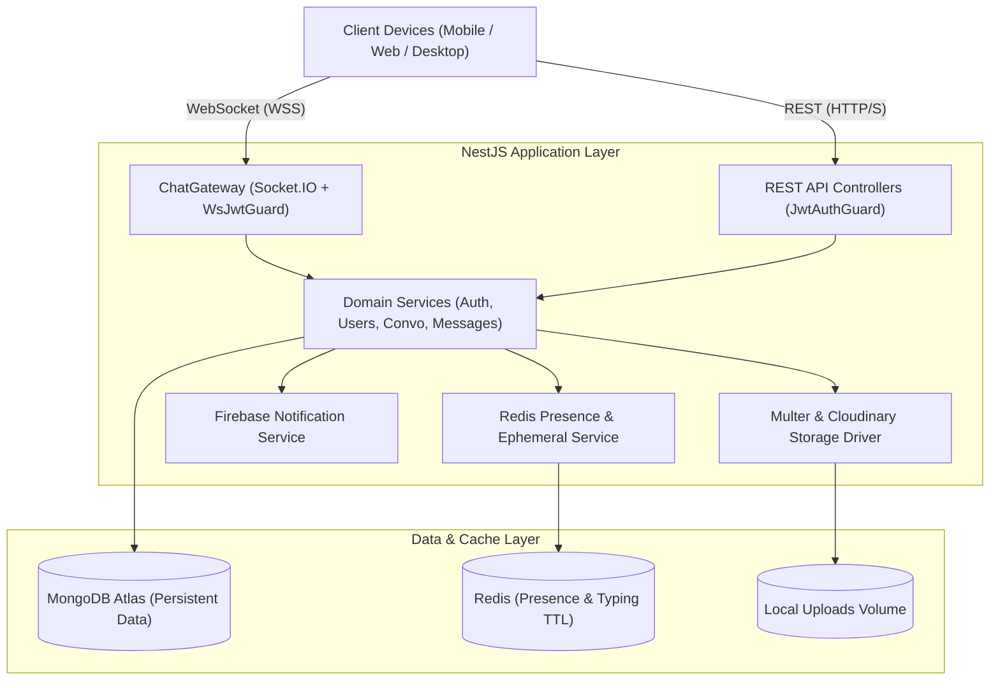

# Zylo Backend 🚀

> High-throughput, production-grade real-time messaging engine and RESTful API powering Zylo, built with **NestJS**, **Socket.IO**, **MongoDB**, and **Redis**.

---

## 📑 Overview

The Zylo backend provides an enterprise-ready foundation for low-latency communication, presence management, and media sharing. It is built strictly on modular domain-driven architecture with complete TypeScript typing and comprehensive automated test suites.

### Core Capabilities

- **Real-Time Communication:** Socket.IO WebSocket gateway with JWT handshake verification, isolated direct-messaging rooms, and delivery acknowledgments (`sent` ➔ `delivered` ➔ `read`).
- **Presence & Ephemeral State:** Redis-backed user presence (`online`, `offline`, and ISO `lastSeen` timestamps) alongside auto-expiring ephemeral typing indicators (4-second TTL).
- **Authentication & Session Security:** Dual-token JWT architecture (short-lived access tokens + rotating refresh tokens), bcrypt password salting, and rapid token revocation.
- **Media Management:** Multipart uploads with automatic MIME-type inspection, local storage fallback, and seamless Cloudinary CDN hosting.
- **Push Notification Pipeline:** Firebase Cloud Messaging (FCM) device registry for dispatching instant notifications to background/offline users.
- **Interactive Documentation:** Live OpenAPI / Swagger schema generation available at `/api/docs`.

---

## 🏗️ Architecture



---

## 📦 Directory Structure

```text
backend/
├── src/
│   ├── main.ts                    # NestJS bootstrap, Swagger & CORS config
│   ├── app.module.ts              # Root dependency injection module
│   ├── config/                    # Environment validation & configuration
│   ├── database/                  # Mongoose connection & schema registrations
│   │   └── schemas/               # User, Conversation, Message, DeviceToken schemas
│   ├── redis/                     # Redis service for presence and typing indicators
│   ├── common/                    # Guards, decorators, filters, pagination DTOs
│   ├── auth/                      # Authentication, token rotation, and bcrypt guards
│   ├── users/                     # User management, search, and presence resolution
│   ├── conversations/             # Conversation room management and unread counters
│   ├── messages/                  # Message persistence and cursor pagination
│   ├── moments/                   # Ephemeral Moments with friends
│   ├── gateways/                  # ChatGateway (Socket.IO real-time events)
│   ├── uploads/                   # Local file & Cloudinary CDN driver
│   └── notifications/             # FCM push notification dispatcher
├── test/                          # Unit & integration test suites
├── Dockerfile                     # Multi-stage production container build
├── package.json                   # Dependencies and scripts
└── tsconfig.json                  # TypeScript compiler settings
```

---

## ⚡ Environment Setup

Copy `.env.example` to `.env`:

```bash
cp .env.example .env
```

Configure your environment variables:

```ini
PORT=3000
MONGODB_URI=mongodb://localhost:27017/zylo
REDIS_HOST=localhost
REDIS_PORT=6379
JWT_ACCESS_SECRET=your_jwt_access_secret_key
JWT_ACCESS_EXPIRATION=15m
JWT_REFRESH_SECRET=your_jwt_refresh_secret_key
JWT_REFRESH_EXPIRATION=7d
UPLOAD_DRIVER=local
UPLOAD_DESTINATION=./uploads
CLOUDINARY_CLOUD_NAME=
CLOUDINARY_API_KEY=
CLOUDINARY_API_SECRET=
FIREBASE_PROJECT_ID=
FIREBASE_CLIENT_EMAIL=
FIREBASE_PRIVATE_KEY=
```

---

## 🚀 Running the Server

### Development Mode

```bash
# Install dependencies
npm install

# Start development server with hot-reload
npm run start:dev
```

The server will start on `http://localhost:3000`.
Explore the interactive API documentation at `http://localhost:3000/api/docs`.

### Production Build

```bash
# Compile TypeScript to JavaScript in /dist
npm run build

# Run compiled build
npm run start:prod
```

---

## 🧪 Testing

```bash
# Run automated Jest unit tests
npm test

# Run tests in watch mode
npm run test:watch

# Generate code coverage report
npm run test:cov
```

---

## 📄 License

This project is licensed under the MIT License.
