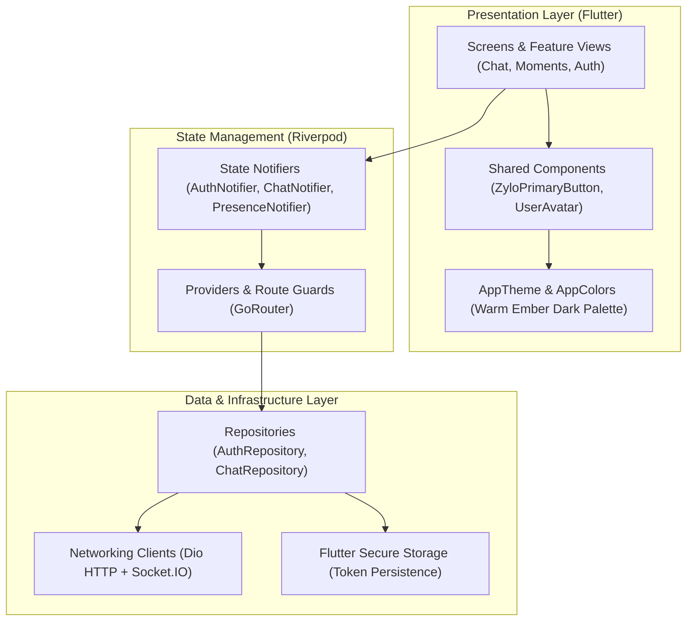

# Zylo Mobile & Web Client 📱✨

> Fluid, cross-platform messaging client built with **Flutter**, **Riverpod**, and **Material 3**, showcasing custom typography, smooth micro-interactions, and real-time synchronization.

---

## 📑 Overview

The Zylo frontend provides an ultra-responsive, polished messaging experience across iOS, Android, macOS, and Web. Crafted with an editorial aesthetic—combining warm charcoal tones, warm amber/ember accents, and the timeless **Instrument Serif** display typeface—Zylo balances elegant visual design with robust engineering.

### Key Highlights

- **Modern Architecture:** Unidirectional data flow powered by **Flutter Riverpod** state notifiers, domain-separated repositories, and declarative **GoRouter** route guards.
- **Real-Time Responsiveness:** Low-latency bi-directional messaging with Socket.IO, live typing status, online/offline presence indicators, and message status updates (`sent` ➔ `delivered` ➔ `read`).
- **Resilient Networking:** Dio client with automated token refresh interceptor to quietly handle JWT renewal without interrupting the user.
- **Custom Design System:** Material 3 foundation customized with warm surface palettes, glassmorphic header accents, dynamic badge counters, and unified touch feedback (`ZyloPrimaryButton`).
- **Rich Media & Camera:** In-app capture and preview, photo attachments, voice notes, and document transfers.
- **Moments Feature:** Ephemeral connection moments shared between friends with rolling countdown indicators and real-time updates.

---

## 🏗️ Architecture



---

## 📁 Directory Structure

```text
frontend/lib/
├── config/                  # GoRouter setup, app routes, and auth redirect guards
├── core/
│   ├── network/             # Dio client, API endpoints, token refresh interceptor
│   ├── storage/             # FlutterSecureStorage token helpers
│   ├── theme/               # AppTheme, AppColors, AppTypography, AppRadius, AppShadows
│   └── utils/               # DateTime formatters, validators, and helpers
├── features/
│   ├── auth/                # Splash, Login, Register, and Onboarding screens
│   ├── camera/              # In-app camera capture, preview, and send screen
│   ├── chat/                # Real-time chat, conversation list, search & bubbles
│   ├── home/                # Main scaffold, navigation bar, and tab coordination
│   ├── moments/             # Shared moments view, streak cards, and modals
│   ├── profile/             # Profile viewer and user profile editor
│   ├── settings/            # Appearance, notifications, and security settings
│   └── users/               # Search users and friend profile overview
├── models/                  # Type-safe Dart models (User, Message, Conversation, Moment)
├── providers/               # Riverpod StateNotifiers and dependency providers
├── repositories/           # Repositories abstracting API & cache interactions
├── services/                # Low-level SocketService, ApiService, MediaService
├── widgets/                 # Reusable UI widgets (ZyloPrimaryButton, UserAvatar, etc.)
└── main.dart                # App entrypoint & Riverpod ProviderScope setup
```

---

## 🚀 Getting Started

### Prerequisites

- [Flutter SDK](https://flutter.dev/) (v3.24+ or latest stable)
- Dart SDK (v3.5+)
- Xcode (for iOS/macOS) or Android Studio (for Android)

### Installation & Run

```bash
# 1. Fetch Flutter dependencies
flutter pub get

# 2. Run static analysis to verify code health
flutter analyze

# 3. Execute automated test suite
flutter test

# 4. Launch on target device:
# For macOS desktop:
flutter run -d macos

# For Google Chrome:
flutter run -d chrome

# For connected Android/iOS simulator or phone:
flutter run
```

---

## 🧪 Testing

The frontend contains comprehensive unit and widget tests:

```bash
flutter test
```

Tests cover:
- **`AuthRepository`**: Secure token persistence, credential caching, and logout purging.
- **`Models`**: JSON serialization and deserialization for User, Message, Conversation, and Moment schemas.
- **`Widgets`**: Splash branding smoke tests, `UserAvatar` fallback rendering, `MessageStatusIcon` transitions, and `MomentBadge` rendering.

---

## 🎨 Design System

- **Primary Accent:** Warm Ember (`#E56A38` / `#FF7A45`)
- **Backgrounds:** Pitch Black (`#080807`) & Dark Charcoal (`#131311`)
- **Display Serif:** Instrument Serif (Regular & Italic)
- **Body & Sans:** System Inter / San Francisco

---

## 📄 License

This project is licensed under the MIT License.
